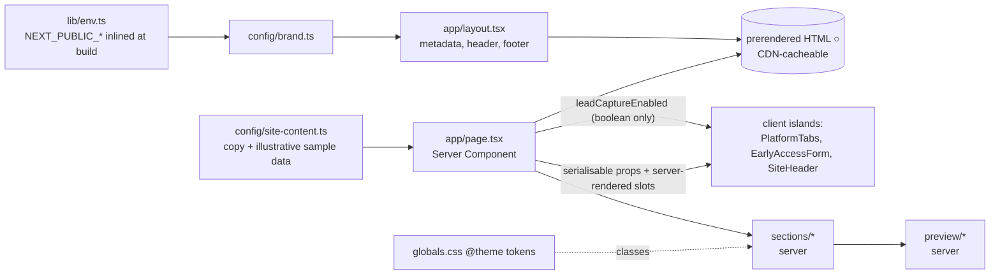

# 03 · Technical architecture: Meraki landing page

| | |
|---|---|
| Status | Phase A, documentation only. **No code exists yet.** Everything below describes Phase B. |
| Date | 2026-10-29 |
| Brand | "Meraki" is a **temporary** name. All brand strings come from `src/config/brand.ts` (see §10). |
| Source of truth | [specs/01](./01-product-requirements.md) (requirements) and [specs/06](./06-feature-status.md) (feature status); design tokens in [specs/05](./05-design-system.md). The Phase A decisions brief (2026-10-29) is not kept in the repo; its decisions are folded into these specs, and "brief §n" below only names where a decision came from. Concerns are listed in §16. |
| Related | [specs/01-product-requirements.md](./01-product-requirements.md) (form fields FR-30–41, SEO S-01–08, open questions OQ-n), [specs/05-design-system.md](./05-design-system.md) (design system and tokens), [specs/06-feature-status.md](./06-feature-status.md) (feature status). |

Evidence labels:
- **Verified** means a command was run in a scratch probe on this machine on 2026-10-29. The probe was a throwaway `create-next-app` project outside this repo, part of the Phase A capture (2026-10-29).
- **Observed** marks a fact about the Clarion Health reference site. These cite the Phase A analysis files, e.g. "ref: components.md §4.1".
- **Provisional** marks a recommendation that the owner has not approved yet.

---

## 0. Implementation notes (Phase B, 2026-10-29)

Where the build settled a choice this document left open:

| Topic | Decision as built |
|---|---|
| FAQ | Native `<details>/<summary>` with an `h3` inside each summary: zero JS (FR-51). |
| Mobile menu without JS (FR-19) | The sheet needs JS. Without JS, the CTA (a plain anchor) and the footer, which links to every nav destination, keep all sections reachable. |
| Platform tabs without JS (FR-24) | The component renders all four descriptions as a definition list and all previews stacked until hydration, then switches to the tabs pattern. |
| Lead gate | `src/lib/lead-config.ts` → webhook + contact email + `legal.privacy.reviewStatus === "reviewed"` (01 D-2). Shipped as `"draft"`. |
| Copyright year | `CopyrightYear` uses `'use cache'` + `cacheLife("days")`, so `/` stays static with a 1-day revalidate (cacheComponents). |
| Preview layout | Previews and their inner lists use container queries (`@container`) on their own roots; the platform grid uses `minmax(0, 1fr)` tracks to stop min-content overflow. |
| `server-only` | Used without installing the package (Next resolves it); Vitest aliases it to a stub. |
| OG image URL | Without `NEXT_PUBLIC_SITE_URL`, Next resolves OG image URLs against `http://localhost:3000` (build warning). Set the variable on any non-Vercel host before sharing links. |
| Motion (D-9) | `components/ui/Marquee.tsx` (client: pause state; CSS keyframes `marquee-rtl/ltr` in globals.css) and `components/sections/PinnedRail.tsx` (client: `useSyncExternalStore` media query, ResizeObserver, rAF-throttled scroll). Both are inert under reduced motion. |
| Tests | `npm test`: 41 tests in 5 files. Playwright e2e (§12.4) was not added to the repo. |


## 1. Current state (verified 2026-10-29)

| Item | State |
|---|---|
| Repository root | Empty apart from Phase A docs (`CLAUDE.md`, `specs/`). It has no `package.json`, source, tests, env files or lockfile. |
| Git | **Not a git repository.** git 2.50.1 is installed. |
| Product | None. There is no dashboard, API, database, auth or lead backend. |
| Brand assets | None. There is no logo, photography, domain, contact details or legal text. |
| Runtime | macOS arm64, **node v22.23.1**, **npm 10.9.8**. pnpm and bun are not installed. |
| Other tools | netlify-cli 27.5.1 is installed globally (note only: there is no account or site, and nothing has been deployed). |

**There are no project-specific commands yet.** Every `npm run …` command in this doc becomes available only after the Phase B scaffold. Only the commands marked Verified in §2.2 ran in the scratch probe on 2026-10-29 (`npm run build`, `npm run lint`, and the underlying `npx tsc --noEmit` / `npx vitest run`). All others (`npm run dev`, `npm run start`, `npm run format`, `npm run test:e2e`, and the `typecheck` / `test` scripts themselves) are unverified until Phase B.

---

## 2. Recommended stack (**Provisional** until the owner approves Phase B)

### 2.1 Packages

Versions are the npm `latest` dist-tags, re-checked on 2026-10-29.

| Package | Version | Kind | Rationale |
|---|---|---|---|
| `next` | **16.4.3** | dep | Current stable. Uses App Router, `src/` and Turbopack by default. `/` prerenders static and one dynamic Route Handler serves `/api/lead`. Engines `node >=20.9.0`, so node 22 is fine. |
| `react` / `react-dom` | **19.3.0** (scaffold pins it exactly; 19.3.1 is `latest`) | dep | Server Components by default and small client islands. Keep the scaffold pin. A bump to 19.3.1 is optional and **not verified**. |
| `typescript` | **^5** (resolves 5.9.3) | dev | `create-next-app` writes `^5`. TypeScript 7.0.2 (the native port) is `latest` but untested with Next here, so it is **not adopted**. |
| `tailwindcss` + `@tailwindcss/turbopack` | **4.3.3** (`^4`) | dev | CSS-first: tokens live in `@theme` in `globals.css` and there is no JS config. The scaffold wires the Turbopack loader in `next.config.ts`, not PostCSS. Keep that. |
| `eslint` | **^10** (10.13.0) | dev | The scaffold writes `^9` (9.39.5), which npm flags as **deprecated**. 10.13.0 was verified working with `eslint-config-next`. |
| `eslint-config-next` | **16.4.3** | dev | Flat config with core-web-vitals and TypeScript rules (includes jsx-a11y and react-hooks). Peer dependency `eslint >=9`. |
| `@types/node` | **^22** (22.20.5) | dev | The scaffold writes `^20`. `^22` matches the node 22 runtime and **is required** by vitest's peer range (otherwise ERESOLVE, §3.3). |
| `@types/react` / `@types/react-dom` | `^19` (19.3.0) | dev | Scaffold default. |
| `zod` | **4.6.7** | dep | The **only** added runtime dependency. One lead schema is shared by client and server. Uses the v4 API (`z.email()`). |
| `vitest` | **5.0.5** | dev | Unit, component and Route Handler tests. Peer `vite ^6.4‖^7‖^8`, peerOptional `@types/node ^22‖>=24`. |
| `@vitejs/plugin-react` | 6.1.2 | dev | JSX transform for vitest. |
| `jsdom` | 30.1.3 | dev | DOM environment for component tests. |
| `@testing-library/react` + `@testing-library/dom` | 16.3.3 + 10.4.2 | dev | Component tests. Peer `@testing-library/dom ^10`. |
| `@testing-library/user-event` | 14.6.8 | dev | Realistic keyboard input for the tabs, menu and form tests. The version was checked, but it was **not installed in the probe**. |
| `@testing-library/jest-dom` | 7.0.1 | dev, optional | Readable matchers such as `toHaveAttribute`. Version checked, **not installed in the probe**. |
| `prettier` | **3.9.10** | dev | Formatting. `prettier-plugin-tailwindcss` 0.8.1 is optional (version checked, not installed). |
| `@playwright/test` | 1.64.1 | dev, **optional** | Responsive and anchor smoke tests (§12.3). It needs `npx playwright install chromium`, which downloads chromium build v1248 (not cached locally). |

**Deliberately excluded:** UI kits, animation libraries (no GSAP, Swiper or Lottie; the reference loads all three, ref: components.md §5.1), form libraries, icon fonts and icon CDNs, analytics SDKs and CMSs. Icons are inline SVG React components, either hand-authored or copied as SVG from an MIT set such as Lucide or Phosphor. They are never loaded at runtime from a CDN.

### 2.2 What the scratch probe verified, and what it did not

| Check | Result |
|---|---|
| `create-next-app@16.4.3` with the flags in §3.2 | Verified. 364 packages, 0 vulnerabilities, about 4 min install. |
| Scaffolding with `.` inside `HostPG` | **Fails, verified.** npm naming rules reject uppercase: `Could not create a project called "HostPG"…`. It exits with code 2 and writes nothing. |
| Lowercase directory + rsync route | Verified in scratch. |
| `npm run build` (fresh) | Exit 0. Next 16.4.3 (Turbopack) compiled in 4.5 s, with a 2.0 s TS check. `/` and `/_not-found` came out static (`○`). |
| `npm run build` with `src/app/api/lead/route.ts` | Exit 0. `/api/lead` shows as `ƒ (Dynamic)` and `/` is still `○`. |
| `npm run lint`, `npx tsc --noEmit` | Both exit 0, before and after the additions. |
| `npm i -D @types/node@^22 vitest@5.0.5 @vitejs/plugin-react@6.1.2 jsdom@30.1.3 @testing-library/react@16.3.3 @testing-library/dom@10.4.2 prettier@3.9.10` | OK, 0 vulnerabilities. |
| `npx vitest run` | 3 files and 9 tests passed in about 1.1 s: a component render test, a zod schema test, and a Route Handler test. |
| Hardened route tests | 6/6 passed: network error → 502, 200 non-JSON → 502, 200 `{ok:true}` → 200, unconfigured → 503, plus the two regressions of the naive route. |
| ESLint 10.13.0 | Runs with `eslint-config-next` 16.4.3 and still reports `@next/next`, jsx-a11y and TS rules. **Caveat:** the bump was not saved to the probe's `package.json`, so make sure it reads `^10`. |
| next/font (Geist) | The build emits woff2 to `.next/static/media/`. The prerendered HTML preloads them and makes no request to `fonts.googleapis`. The build needs network access to fetch the fonts. |
| `npx prettier --check src` | Runs. |
| **Not verified** | `next start` + curl against a running server (a sandbox restriction blocked it; the handler was tested by importing `POST` directly). Newsreader via next/font (the probe used only Geist). `opengraph-image.tsx`. `robots.ts` / `sitemap.ts`. The Playwright browser download and any e2e run. `user-event` and `jest-dom` installs. Any deploy to Vercel or Netlify. The `--skip-install` scaffold variant. React 19.3.1. `@axe-core/playwright`. |

---

## 3. Scaffold procedure (Phase B, step 1)

### 3.1 Before you start

1. The owner approves Phase B and the stack in §2.
2. **Git** (OQ-7): run `git init` in HostPG *before* scaffolding. The rsync result can then be reviewed as a diff. The scaffold is run with `--disable-git`, so it never creates its own repo.
3. Confirm that `CLAUDE.md` and `specs/` exist in HostPG. The copy step must not touch them.

### 3.2 Scaffold into a lowercase scratch directory

`create-next-app` takes the npm package name from the directory name, and `HostPG` is invalid because it contains uppercase letters. So scaffold elsewhere into `meraki-landing`, which becomes the package name.

```bash
REPO="$(pwd)"          # run from the repository root
SCRATCH="$(mktemp -d)"
cd "$SCRATCH"
CI=1 NEXT_TELEMETRY_DISABLED=1 npx -y create-next-app@16.4.3 meraki-landing \
  --ts --tailwind --eslint --app --src-dir --import-alias "@/*" \
  --use-npm --no-agent-feedback --disable-git --yes
```

`--yes` fills only the options that are not passed, from saved preferences. Every relevant option is passed explicitly, so this is harmless.

### 3.3 Copy into HostPG without clobbering docs

```bash
# 1. dry run: review what would be created
rsync -an --itemize-changes --ignore-existing \
  --exclude 'node_modules/' --exclude '.next/' \
  --exclude 'CLAUDE.md' --exclude 'specs/' \
  "$SCRATCH/meraki-landing/" "$REPO/"

# 2. real copy (same flags, without -n)
rsync -a --ignore-existing \
  --exclude 'node_modules/' --exclude '.next/' \
  --exclude 'CLAUDE.md' --exclude 'specs/' \
  "$SCRATCH/meraki-landing/" "$REPO/"

# 3. install from the scaffold's lockfile, inside HostPG
cd "$REPO" && npm ci
```

- `--ignore-existing` never overwrites a file that already exists. The explicit excludes are a second safeguard for `CLAUDE.md` and `specs/`.
- The scaffold does **not** generate a `CLAUDE.md`. It does generate an `AGENTS.md` that points to the version-matched Next docs in `node_modules/next/dist/docs/`. Keep `AGENTS.md`, and have `CLAUDE.md` reference it. `next dev` re-adds `AGENTS.md` if it is deleted.
- `node_modules/` is excluded so that it is not copied twice. `npm ci` then reproduces the exact lockfile.
- Optional speed-up (**not verified**): add `--skip-install` to the scaffold, skip `npm ci`, and run `npm install` in HostPG.

### 3.4 Post-scaffold changes

| # | Change | Why |
|---|---|---|
| 1 | One install for all dev dependencies: `npm i -D eslint@^10 @types/node@^22 vitest@5.0.5 @vitejs/plugin-react@6.1.2 jsdom@30.1.3 @testing-library/react@16.3.3 @testing-library/dom@10.4.2 @testing-library/user-event@14.6.8 prettier@3.9.10` | Installing vitest while `@types/node` is still `^20` **fails with ERESOLVE (verified)**. Bump both in the same command. Afterwards confirm that `package.json` reads `"eslint": "^10"`. |
| 2 | `npm i -E zod@4.6.7` | Shared lead schema. `-E` writes the exact version (`"zod": "4.6.7"`), not `^4.6.7`. |
| 3 | Optional: `npm i -D @testing-library/jest-dom@7.0.1 prettier-plugin-tailwindcss@0.8.1` and `npm i -D @playwright/test@1.64.1 && npx playwright install chromium` | Nicer test matchers and class sorting. Playwright is for e2e only (§12.3). |
| 4 | `package.json` scripts: add `"typecheck": "tsc --noEmit"`, `"test": "vitest run --passWithNoTests"` (so the gate passes before the first test exists), `"format": "prettier --write ."`, and optional `"test:e2e": "playwright test"`. Keep the scaffold's `dev`, `build`, `start` and `lint` (`lint` is `eslint`, not `next lint`). | Gives one command per quality gate. |
| 5 | Add `vitest.config.mts` (verified shape): `defineConfig({ plugins: [react()], resolve: { tsconfigPaths: true }, test: { environment: "jsdom" } })`. Route Handler tests start with `// @vitest-environment node`. | jsdom by default, node for the handler. |
| 6 | `.gitignore`: the scaffold ignores **all** `.env*` files. Add `!.env.example` so that the template is committed. | Otherwise `.env.example` is silently ignored. |
| 7 | Remove the scaffold demo: `public/{file,globe,next,vercel,window}.svg`, the Next.js `favicon.ico`, the demo markup in `page.tsx`, and `Geist_Mono`. | No third-party branding ships with the site. Replace the favicon with a text-wordmark `src/app/icon.tsx` or an owner-supplied icon. |
| 8 | `globals.css`: replace the scaffold's `:root` and `prefers-color-scheme: dark` block with Meraki `@theme` tokens (§10.3). | **Provisional.** No dark theme is designed, so the scaffold's auto-dark would invert the page. |
| 9 | `next.config.ts`: **keep** `cacheComponents: true`, `partialPrefetching: true` and the `turbopack.rules["*.css"]` Tailwind loader. Remove them only if they cause friction (see §14.3). | These are the scaffold defaults and the build passed with them. |
| 10 | Rewrite the scaffold `README.md` with the real commands, or delete it in favour of `CLAUDE.md`. | It is Next boilerplate. |
| 11 | Create `.env.example` (§11.2). | Documents the env names without any values. |
| 12 | **Provisional:** add `.nvmrc` containing `22` and `"engines": { "node": ">=20.9.0" }`. | Pins hosts and contributors to the same node major as the verified machine. |

Gate: `npm run lint && npm run typecheck && npm test && npm run build` must all exit 0 before any feature work starts.

---

## 4. Application structure

The tree follows the decisions brief §4. One addition is marked †.

```
src/
  app/
    layout.tsx            # <html lang="en">; next/font (Newsreader + Geist) as CSS vars; root metadata built from brand.ts;
                          # skip link → #main; <SiteHeader/>; <main id="main">{children}</main>; <SiteFooter/>
    page.tsx              # Server Component; composes the 12 sections in order; reads the lead-config *boolean* (§9.4)
    globals.css           # @import "tailwindcss"; @theme tokens (single source of colour, type, spacing, breakpoints); base layer
    privacy/page.tsx      # static privacy notice for the early-access form (owner/legal review required)
    terms/page.tsx        # static "terms to be published" placeholder (owner decision required)
    api/lead/route.ts     # POST only: rate limit → parse → zod → config check → forward to webhook → honest status
    opengraph-image.tsx   # optional generated OG image (next/og); no external assets
    robots.ts             # robots rules (§11)
    sitemap.ts            # entries only when NEXT_PUBLIC_SITE_URL is set (§11)
    icon.tsx              # † optional generated favicon (text monogram) replacing the Next.js favicon
    not-found.tsx         # † optional branded 404; otherwise Next's default /_not-found is used
  config/
    brand.ts              # name, tagline, description, nav links, CTA labels, contact (from env, optional), social: []
    site-content.ts       # all section copy, FAQ, tab data, step data, illustrative sample data (flag `illustrative: true`)
    legal.ts              # /privacy and /terms draft text + reviewStatus ("draft" until owner/legal review)
  components/
    layout/   SiteHeader (client), SiteFooter
    ui/       Button, Container, Section, SectionHeader, Eyebrow, IconBadge, Icon (inline SVG set), VisuallyHidden
    preview/  PreviewFrame, DashboardPreview, OccupancyGrid, RentLedger, TenantList, OpsList
    sections/ Hero, Problem, Outcomes, PlatformTabs (client), AttentionDashboard, FeatureShowcase, DailyWorkflow,
              GettingStarted, WhyMeraki, EarlyAccess (+ EarlyAccessForm, client), Faq, FinalCta
  lib/
    lead-schema.ts        # shared zod schema + inferred types + field limits (client and server)
    env.ts                # typed, validated optional env reads; never logs values
    rate-limit.ts         # best-effort in-memory sliding window (server only)
    lead-config.ts        # isLeadCaptureEnabled(): webhook + contact email + reviewed privacy notice (§9.4)
```

† `icon.tsx`, `not-found.tsx`, `robots.ts`, `sitemap.ts` and `lib/rate-limit.ts` are small files that the brief's tree does not list. They implement behaviour the brief requires (SEO, honest 404, rate limit). Each is **Provisional**.

| Folder | Responsibility | Rules |
|---|---|---|
| `app/` | Routes, metadata, and the one API handler. | No copy strings in route files. They import from `config/`. |
| `config/` | **Every** brand string and all marketing copy. | Plain typed data only: no JSX and no env reads, except `brand.ts` reading through `lib/env.ts`. Changing the brand name is a single-file edit. |
| `components/ui` | Brand-agnostic primitives. | Styled only with token classes (`bg-canvas`, `text-ink` …), never raw hex values. |
| `components/preview` | HTML/SVG "product" mock-ups built from sample data. | Every frame renders the caption **"Illustrative preview · sample data"**. Data comes from `site-content.ts` entries flagged `illustrative: true`. |
| `components/sections` | One component per landing section. Each owns its `id` anchor. | Copy arrives as props or imports from `config/`. No feature claim may go beyond the statuses in [specs/06-feature-status.md](./06-feature-status.md). |
| `lib/` | Non-UI logic shared by client and server (the schema), and server-only helpers (env, rate limit). | `rate-limit.ts` and the server parts of `env.ts` import `server-only`. **Provisional:** the `server-only` package ships with Next and needs no new dependency, but this was not verified in the probe. |

---

## 5. Routing

| Route | File | Rendering | Notes |
|---|---|---|---|
| `/` | `app/page.tsx` | **Static prerender (`○`)** | A single long page with anchored sections. |
| `/privacy` | `app/privacy/page.tsx` | Static | A DPDP-oriented notice at collection: what is collected, why, processors, and how to withdraw consent or contact us. Shows "Draft — pending review" while `legal.privacy.reviewStatus` is `"draft"` (01 D-6). No invented retention period. |
| `/terms` | `app/terms/page.tsx` | Static | Draft placeholder marked "Draft — pending review": terms will be published before the product is available (01 D-6). |
| `/api/lead` | `app/api/lead/route.ts` | **Dynamic (`ƒ`)** | Exports `POST` only. Next answers other methods with 405. |
| 404 | default `/_not-found`, or optional `app/not-found.tsx` | Static | A branded version links back to `/` and repeats no claims. |
| `/opengraph-image`, `/icon`, `/robots.txt`, `/sitemap.xml` | metadata files | Static (generated at build) | See §11. |

There are no other routes: no `/login`, `/signup`, `/pricing`, `/blog` or `/dashboard`. Owner authentication is **Not implemented** and must not be linked ([specs/06-feature-status.md](./06-feature-status.md)).

### 5.1 In-page anchors (exact ids)

| id | Section | Linked from |
|---|---|---|
| `main` | `<main>` wrapper (skip-link target) | Skip link |
| `hero` | Hero | none |
| `problem` | Problem | none |
| `outcomes` | Outcomes | none |
| `platform` | Platform tabs | Nav "Product", footer "Platform" |
| `attention` | Attention dashboard | none |
| `features` | Feature showcase | Nav "Features", footer "Features" |
| `how-it-works` | Owner's month flow | Nav "How it works", hero "See how it works", footer |
| `getting-started` | Getting started steps | none |
| `why` | Why Meraki | none |
| `early-access` | Early-access form | Nav "Contact", nav CTA, hero CTA, why CTA, final CTA, footer "Early access" / "Contact" |
| `faq` | FAQ | Footer "FAQ" |
| `final-cta` | Final CTA | none |

- The nav holds exactly 4 links (Product, Features, How it works, Contact) plus the CTA "Get early access".
- Every anchored section gets `scroll-margin-top: var(--spacing-nav-offset)` (5.5rem, specs/05 §5): the fixed nav pill (56px tall + 8px top offset; ref: components.md §1.1) plus air, so headings are never hidden under the nav.
- `scroll-behavior: smooth` applies only inside `@media (prefers-reduced-motion: no-preference)`.
- Observed: the reference's skip link targets `#main`, but no `<main>` exists, so the script throws (ref: components.md §11). Meraki renders a real `<main id="main">`.

---

## 6. Component architecture

### 6.1 Server vs client

Everything is a **Server Component** by default. That means zero JS for static marketing content, the page stays prerenderable, and copy and sample data never ship in client JS bundles (they appear only in the prerendered HTML/RSC payload).

| Client component (`"use client"`) | Why it needs the client | Props it receives |
|---|---|---|
| `SiteHeader` | Mobile menu open state, Esc handler, focus return, body scroll lock. The menu is used below 992px. | `brand.name`, `nav` links, `cta`. Plain serialisable data only. |
| `PlatformTabs` | Selected-tab state and the WAI-ARIA tabs keyboard model (roving tabindex, arrow keys). | Tab data from `site-content.ts`, plus the matching preview panels passed as **server-rendered `ReactNode` children/slots**, so the previews stay server components. |
| `EarlyAccessForm` | Field state, client-side validation, submit lifecycle, focus management. | `leadCaptureEnabled: boolean`, `contact: { email?: string; phone?: string }`, field labels and options. Never the webhook URL. |
| `Faq` (only if needed) | **Preferred: native `<details>/<summary>`, server-rendered with zero JS.** Switch to a client accordion (`button[aria-expanded]` + region) only if the needed styling or behaviour cannot be done accessibly with `<details>`. Decide in implementation and record the choice. | `items: {q, a}[]` |

Rules:
- Client props must be serialisable, so no functions and no class instances. Pass only the slice of content a component needs, not all of `site-content.ts`.
- Client components never import `lib/env.ts` server parts or `rate-limit.ts`; `server-only` enforces this.
- `GettingStarted` uses a native CSS scroll-snap rail below 992px and a 4-up row from 992px, with **no JS**. Observed: the reference uses a GSAP/Swiper scroll-jacked pin that adds 1,000px+ of dead scroll (ref: components.md §5.3). This is a deliberate deviation.
- Observed: the reference fades tab panes with a stacked grid so the height never jumps (`grid-area: 1/1`, 300ms in / 100ms out), and it never swaps the image per tab (ref: components.md §4.1). Meraki keeps the stacked-grid crossfade and **does** swap the preview per tab.

### 6.2 Component inventory (props sketch)

```ts
// ui/
Button:        { variant: "primary-dark" | "primary-light" | "ghost-on-dark" | "ghost-on-light";
                 href?: string; type?: "button" | "submit"; fullWidthBelowSm?: boolean; children; ...aria }
               // renders <a> when href, else <button>; min height 44px on touch (design deviation from ref 42px)
Container:     { as?: "div" | "section"; children }       // max-w 87.5rem + fluid inline padding token
Section:       { id: SectionId; tone: "canvas" | "tint" | "dark"; labelledBy: string; children }
               // <section id aria-labelledby>, applies --spacing-section, scroll-margin-top: var(--spacing-nav-offset)
SectionHeader: { eyebrow?: string; title: string; titleId: string; lead?: string; align?: "center" | "start"; level?: 1 | 2 }
Eyebrow:       { children }
IconBadge:     { icon: IconName; variant?: "disc" | "corner" }   // gradient disc; corner = clipped circle (Why cards)
Icon:          { name: IconName; size?: number; title?: string } // inline SVG; aria-hidden unless title given
VisuallyHidden:{ children; as?: "span" | "div" }

// layout/
SiteHeader:    { name: string; links: NavLink[]; cta: Cta }      // client
SiteFooter:    { name: string; columns: FooterColumn[]; contact: { email?: string; phone?: string } }
               // contact links render only when set; © year (see §14.3); no social icons

// preview/
PreviewFrame:  { title: string; children; caption?: string }    // caption defaults to "Illustrative preview · sample data"
DashboardPreview: { data: DashboardSample }                     // summary tiles + recent recorded payments + dues list
OccupancyGrid: { rooms: RoomSample[] }                           // bed grid: occupied / vacant only (specs/05 §13)
RentLedger:    { rows: RentRowSample[] }                         // ₹ rows, status chip Paid / Due / Overdue (+ neutral)
TenantList:    { tenants: TenantSample[] }                       // fictional names, room/bed, move-in date
OpsList:       { items: OpsItemSample[] }                        // property records / notes to follow up

// sections/
Hero, Problem, Outcomes, AttentionDashboard, FeatureShowcase, DailyWorkflow, GettingStarted, WhyMeraki, Faq, FinalCta:
               { content: <SectionContent from site-content.ts> }   // server
PlatformTabs:  { tabs: { id: string; label: string; description: string }[]; panels: Record<string, ReactNode>; cta: Cta } // client; one shared CTA below the panels
EarlyAccess:   { content; leadCaptureEnabled: boolean; contact }  // server wrapper (heading, DPDP notice) → EarlyAccessForm (client)
```

All `*Sample` types carry `illustrative: true`. Use obviously fictional Indian names and ₹ amounts. Never use a real person, property or statistic.

### 6.3 Accessibility contract (implementation-level)

- **One `h1`** (Hero), then an `h2` per section and an `h3` per card or step. Observed: the reference places a modal `h3` before its `h1` (ref: components.md §11).
- Landmarks: `header`, `nav[aria-label="Primary"]`, `main#main`, `footer`. The reference has no `<footer>` landmark (ref: components.md §11).
- **Tabs:** `role="tablist"` / `tab` / `tabpanel`, `aria-selected`, `aria-controls`, roving `tabindex`. Left/Right and Up/Down move between tabs; Home and End jump to the first and last. Inactive panels stay mounted but get `hidden` (or `inert`) so screen readers skip them.
- **Mobile menu:** a `<button aria-expanded aria-controls aria-label="Open menu">` with a ≥44×44 target. Esc closes it and focus returns to the toggle. Focus is trapped within the header (menu button + sheet + CTA), body scroll is locked, and the CTA stays visible in the pill.
- **Visible `:focus-visible` ring** on every interactive element: 2px outline with 2px offset. Observed: the reference removes outlines on tabs and buttons (ref: components.md §11).
- **Form:** real `<label for>`; required fields marked in text, not by colour only; an error summary with links to fields; an `aria-live="polite"` status region; `aria-busy` on the form while pending.
- A global `@media (prefers-reduced-motion: reduce)` block disables the tab crossfade, smooth scroll and hover transitions.

---

## 7. Data flow

### 7.1 Static content → page (build time)



### 7.2 Lead submission (request time)

```mermaid
sequenceDiagram
  participant U as Visitor (browser)
  participant F as EarlyAccessForm (client)
  participant R as POST /api/lead (Route Handler)
  participant W as LEAD_WEBHOOK_URL (owner-controlled)
  U->>F: fill fields, tick consent, submit
  F->>F: zod parse (same schema); on error → error summary, focus it, no request
  F->>R: fetch JSON (button disabled, aria-busy)
  R->>R: rate limit → parse/size → zod → config check
  alt invalid / limited / unconfigured
    R-->>F: 400 | 429 | 503 JSON
  else valid and configured
    R->>W: POST picked fields (8 s timeout)
    W-->>R: must answer JSON {"ok": true}
    R-->>F: 200 {ok:true} only after ack, else 502
  end
  F->>U: success message (focus) ONLY on 200 + {ok:true}; otherwise honest error, input kept
```

ASCII fallback: `form → (client zod) → /api/lead → (rate limit, zod, config) → webhook (8s, ack {ok:true}) → 200 | 400 | 429 | 502 | 503 → UI state`.

No other data leaves the browser: no analytics, no third-party scripts, and no cookies set by the app.

---

## 8. Existing APIs and integrations

**There are none.** No backend, database, CRM, email provider, payment gateway, WhatsApp, Tally, bank or UPI integration exists. None may be shown or implied on the page ([specs/06-feature-status.md](./06-feature-status.md): integrations are **Not planned (do not claim)**).

The only network integration Phase B adds is the outbound POST to an **owner-configured** webhook (`LEAD_WEBHOOK_URL`). Which tool sits behind it (a Google Sheet via Apps Script, Make/n8n with an explicit webhook-response step, a CRM, or email) is **OQ-1**. It must meet the acknowledgement rule in §9.2 (plain Zapier Catch Hooks cannot). That processor must be named in `/privacy`.

---

## 9. `/api/lead` contract (new)

### 9.1 Request

`POST /api/lead` with `Content-Type: application/json` and a body of at most about 8 KB (**Provisional** limit; anything larger gets 400).

Field names, limits and labels follow [specs/01-product-requirements.md](./01-product-requirements.md) §8.5. If that spec changes, it wins and this table must be updated.

| Field | Type / rule | Required |
|---|---|---|
| `name` | string, trimmed, 2–80 chars (**Provisional**) | yes |
| `property` | string, trimmed, 2–120 chars (**Provisional**) | yes |
| `phone` | string. Spaces and hyphens are stripped, then it must be 10 digits starting 6–9 with an optional `+91` or `0` prefix, e.g. `^(?:\+91\|0)?[6-9]\d{9}$` (**Provisional**, Indian mobiles only). Empty string allowed. | one of `phone` / `email` |
| `email` | `z.email()`, ≤254 chars. Personal domains such as Gmail are accepted. Empty string allowed. | one of `phone` / `email` |
| `city` | string, trimmed, 2–60 chars | yes |
| `beds` | enum. Values are **Provisional** (OQ-13) and map to the 01 labels "Under 20 / 20–50 / 51–150 / More than 150": `"under-20" \| "20-50" \| "51-150" \| "over-150"` | yes |
| `properties` | enum `"1" \| "2-3" \| "4+"` | no |
| `challenge` | string, ≤500 chars | no |
| `consent` | `z.literal(true)`: an unticked box fails | yes |
| `website` | honeypot: must be absent or `""` (`z.string().max(0)`) | must be empty |

- A refinement requires at least one of `phone` / `email` to be non-empty. The error is attached to both fields.
- The schema lives in `lib/lead-schema.ts`. The client imports it for pre-validation and the server for authority. The visible labels and option text live in `site-content.ts`; the enum *values* are internal.
- The honeypot input is visually hidden, `tabindex="-1"`, `autocomplete="off"` and `aria-hidden="true"`, and it is never forwarded.

### 9.2 Processing order (**Provisional**)

1. **Rate limit** by the platform-trusted client IP: `x-real-ip` on Vercel, `x-nf-client-connection-ip` on Netlify. Fall back to the last (proxy-appended) `x-forwarded-for` hop, never the first (clients can forge it). Best-effort and in-memory per instance: about 5 requests per 10 minutes. → 429.
2. **Parse:** wrong content type, unparsable JSON, or an oversize body. → 400.
3. **Validate** with zod. Schema failures (with `fieldErrors`) and a honeypot hit (no `fieldErrors`) both → 400.
4. **Config:** lead capture not enabled (§9.4: webhook, contact email and reviewed privacy notice all required). → 503.
5. **Forward** the picked fields only (never `website`), plus `submittedAt` (ISO string). Use `fetch(url, { method: "POST", headers: { "content-type": "application/json" }, signal: AbortSignal.timeout(8000) })`.
6. **Acknowledgement:** succeed only if `res.ok` **and** the JSON body has `ok === true`. Anything else, including a thrown network error, DNS failure or timeout, → 502.

**Destination requirement.** The destination MUST return HTTP 2xx with JSON body `{"ok":true}` only after the lead is stored. Zapier Catch Hooks reply with a fixed body (`{"status":"success",…}`) and cannot do this, so they are **not supported**: every lead would be stored while the visitor is told to retry, causing duplicates. Make needs a Webhook Response module and n8n a Respond to Webhook node returning `{ok:true}`. A Google Apps Script `doPost` must return it after `appendRow`.

The probe validated before checking config, so a 503 is returned only for valid submissions. That order is kept (verified).

### 9.3 Responses

All responses are JSON with `Cache-Control: no-store`.

| Status | Body | When | UI behaviour |
|---|---|---|---|
| **200** | `{ "ok": true }` | The webhook positively acknowledged with `{ok:true}`. | The form is replaced by a confirmation message that receives focus. It does not promise a response time (01 FR-36). |
| **400** | `{ "ok": false, "error": "invalid", "fieldErrors": { "<field>": "<message>" } }` | Bad JSON, content type or size (no `fieldErrors`), or schema failure (with `fieldErrors` for **visible fields only**). | Error summary with per-field messages. Focus moves to the summary and input is kept. |
| 400 (honeypot) | `{ "ok": false, "error": "invalid" }` | `website` is non-empty. | The same 400 as other invalid input without `fieldErrors` (01 FR-39). Any 400 with no `fieldErrors` shows "We couldn't accept this submission. Please reload the page and try again." plus the fallback contact links if configured, so a real user whose autofill filled the hidden field has a way out. **Never a fake 200**: that user would otherwise see false success. |
| **429** | `{ "ok": false, "error": "rate_limited" }` + `Retry-After: <seconds>` header | Over the limit. | "Too many attempts. Please wait a minute and try again." (01 FR-40, **Provisional**.) Input is kept. |
| **502** | `{ "ok": false, "error": "upstream" }` | Webhook non-2xx, 2xx without a JSON `{ok:true}` (e.g. an Apps Script HTML error page with status 200), network error, or 8 s timeout. | "We couldn't send your request. Your details are still here — please try again." (01 FR-38.) Input is kept, and the fallback contact links show **only if configured**. |
| **503** | `{ "ok": false, "error": "not_configured" }` | `LEAD_WEBHOOK_URL` is unset. | "Our early-access form isn't connected yet." Pre-filled `mailto:`/`tel:` show only if `NEXT_PUBLIC_CONTACT_*` is set, otherwise "Please try again later." There is never an empty or dead `mailto:`. |
| 500 (defensive) | `{ "ok": false, "error": "server" }` | An unexpected exception in the handler (top-level try/catch). | Same as 502. |
| 405 | Next default | Any method other than POST. | n/a |

Client-side rules:
- `fetch` rejection (offline), a non-JSON body (a platform HTML 500/504), and any response other than **200 + `{ok:true}`** all count as failure.
- The submit button is disabled while pending, which guards against duplicate submits.
- **Provisional:** a 15 s client timeout.

### 9.4 Unconfigured destination: chosen behaviour (**owner-approved 2026-10-29**, 01 D-1/D-2)

Option (b) is final:
- `lib/lead-config.ts` exports `isLeadCaptureEnabled()` = `Boolean(serverEnv.leadWebhookUrl && publicEnv.contactEmail && legal.privacy.reviewStatus === "reviewed")`. `page.tsx` passes **only the boolean** to `EarlyAccessForm`; the route calls the same function.
- **Privacy-review gate:** `src/config/legal.ts` holds `privacy.reviewStatus: "draft" | "reviewed"`. It ships as `"draft"`. Switching it is a deliberate code change made after the owner/legal review, so no env var alone can enable collection.
- **Contact gate:** both `LEAD_WEBHOOK_URL` and `NEXT_PUBLIC_CONTACT_EMAIL` are required. DPDP notice-at-collection needs a usable withdrawal and grievance contact when data is collected, and `/privacy` renders that contact from `NEXT_PUBLIC_CONTACT_EMAIL`. The route applies the same rule (§9.2 step 4), so a webhook without a contact returns 503 and `fetch` is not called.
- If it is `false`, the form renders visibly but inside a disabled `<fieldset>`, with an honest notice banner ("Our early-access form isn't connected yet…") and the fallback contact links, if configured. Visitors therefore never fill in a form that is bound to fail.
- **Caveat:** `/` is prerendered, so the boolean is evaluated **at build time**, while the route reads the env **at request time**. Set `LEAD_WEBHOOK_URL` in the host for both build and runtime, and **redeploy after changing it**. The client still handles a 503 in case the two drift.

### 9.5 Privacy and logging

- **Never log PII.** Do not log the request body, field values, IP addresses or the webhook URL (it often embeds a secret token).
- Log at most an outcome code and the upstream status, e.g. `lead: upstream_failed status=500`.
- There is no `console.log` "storage" of leads and no fake success in dev or demo.
- The rate-limit map holds IPs only in memory and only for the window, with a capped size. It is never persisted.
- DPDP Act 2023:
  - a notice at collection sits next to the form and links to `/privacy`;
  - the consent checkbox is unticked;
  - data is minimised: no ID numbers and no Aadhaar.
- This is not legal advice. The owner must review `/privacy` (OQ-5).

---

## 10. Configuration strategy

### 10.1 `src/config/brand.ts`: single place for identity

```ts
export const brand = {
  name: "Meraki",                       // TEMPORARY — OQ-4
  tagline: "…",                         // from content spec
  description: "…",                     // used for <meta description> and OG
  nav: [
    { label: "Product", href: "#platform" },
    { label: "Features", href: "#features" },
    { label: "How it works", href: "#how-it-works" },
    { label: "Contact", href: "#early-access" },
  ],
  primaryCta: { label: "Get early access", href: "#early-access" },
  secondaryCta: { label: "See how it works", href: "#how-it-works" },
  submitLabel: "Request early access",
  contact: { email: publicEnv.contactEmail, phone: publicEnv.contactPhone }, // undefined when unset
  social: [],                           // none exist; do not invent
  logo: null,                           // text wordmark until a logo is supplied — OQ-3
} as const;
```

This is the canonical shape (also used by 04 T3 and 05 §2). There is no separate `wordmark` field: the wordmark is always rendered from `name`, so changing `name` alone changes it. The locale is not a brand field; `lang` and `og:locale` are set in `layout.tsx` (§11.3).

The rename test: changing `name` must update the title, OG image, header wordmark, footer, form copy and `/privacy` heading. Copy in `site-content.ts` interpolates `brand.name` rather than hard-coding "Meraki".

### 10.2 `src/config/site-content.ts`: all copy and sample data

Typed objects per section (`hero`, `problem`, `outcomes`, `platform.tabs`, `attention`, `features`, `howItWorks`, `gettingStarted.steps`, `why`, `earlyAccess`, `faq`, `finalCta`, `footer`). Sample datasets are flagged `illustrative: true`, and a unit test asserts that every preview dataset has the flag. Feature wording must match the statuses in [specs/06-feature-status.md](./06-feature-status.md).

### 10.3 Design tokens: Tailwind v4 `@theme` in `globals.css`

All values are **Provisional**. **The canonical token list and values are in [specs/05-design-system.md](./05-design-system.md) §19** (with contrast checks in 05 §3.3). This doc does not repeat them, so the two cannot drift. Architecture-level rules:

- Tokens live in `@theme` in `src/app/globals.css` and use 05's names: `--color-*` (including `--color-warning: #8A5A12`, adjusted from the brief's `#A86A12`, which fails AA; 05 §3.3), `--text-*` (Tailwind v4 generates `text-*` utilities only from this namespace), `--spacing-section`, `--spacing-gutter`, `--spacing-nav-offset`, `--container-site`, `--radius-pill` / `--radius-nav` / `--radius-input` / `--radius-form` / `--radius-preview`, and `--ease-out-quart`.
- Tailwind's default breakpoints (640/768/1024/1280) are **overridden** to 480/768/992/1200 to match the reference's switch points. The nav switches at 992 (ref: responsive.md §5).
- Observed: the reference scopes its section-padding override to `h1,h2,h3`, so it never applies (ref: responsive.md §0.3). Meraki defines `--spacing-section` globally.
- Components use token classes only. A lint or review check rejects raw hex values in `components/`.
- **Fonts:** `next/font/google` self-hosts Newsreader and Geist, so the browser makes no request to Google (verified for Geist). Newsreader is loaded as a variable font with **no `weight` option** and `axes: ["opsz"]`, which covers 300 and 400 (passing `weight` together with `axes` throws "Axes can only be defined for variable fonts"); see 05 §4.1. `@theme inline` maps `--font-display` and `--font-sans` to the next/font variables plus the fallback stacks in 05 §19. Load the `latin` subset only. A `devanagari` need depends on OQ-8.

### 10.4 Environment access: `src/lib/env.ts`

- One module parses env with zod: `LEAD_WEBHOOK_URL` must be `https:`, except `http://localhost` or `http://127.0.0.1` (local testing only, **Provisional**); the email must be valid; the site URL must be absolute.
- An **invalid value is treated as unset**. A single warning names the *variable*, never its value.
- It exports `serverEnv` (imports `server-only`) and `publicEnv` (only `NEXT_PUBLIC_*`).
- `NEXT_PUBLIC_*` values are **inlined at build time**, so changing them requires a rebuild.

---

## 11. Environment variables and SEO

### 11.1 Variables

**All are optional. The site builds and runs with none set.** Never commit values: `.env*` is git-ignored, and real values live in the host dashboard or a local `.env.local`.

| Name | Scope | Required? | When unset (or invalid) |
|---|---|---|---|
| `LEAD_WEBHOOK_URL` | **server only** (route at runtime; presence boolean at build) | Required for *live* lead capture only | `/api/lead` → 503 `not_configured`. The form renders disabled with an honest notice (§9.4). |
| `NEXT_PUBLIC_CONTACT_EMAIL` | public (inlined at build) | Required for *live* lead capture (**Provisional** contact gate, §9.4); otherwise optional | No `mailto:` is rendered anywhere (footer, 503/502 fallback), no withdrawal contact on `/privacy`, and lead capture stays disabled (503) even if `LEAD_WEBHOOK_URL` is set. |
| `NEXT_PUBLIC_CONTACT_PHONE` | public (inlined at build) | optional | No `tel:` link is rendered anywhere. |
| `NEXT_PUBLIC_SITE_URL` | public (inlined at build) | optional | No `metadataBase`, no canonical, no `sitemap.xml` entries, and no `Sitemap:` line in robots (§11.3). |

### 11.2 `.env.example` (committed via `!.env.example`)

```dotenv
# All optional. Never commit real values. NEXT_PUBLIC_* are inlined at build time (redeploy after changing).
# Server-only. HTTPS endpoint that must reply JSON {"ok": true} after storing the lead
# (http://localhost or http://127.0.0.1 allowed for local testing only). Plain Zapier Catch Hooks cannot.
LEAD_WEBHOOK_URL=
# Fallback contacts shown only when set (mailto:/tel:). The email is also required for live lead capture.
NEXT_PUBLIC_CONTACT_EMAIL=
NEXT_PUBLIC_CONTACT_PHONE=
# Absolute origin, e.g. https://<your-domain> — enables metadataBase, canonical and sitemap.
NEXT_PUBLIC_SITE_URL=
```

### 11.3 SEO and metadata

| Concern | Implementation |
|---|---|
| Title and description | The Metadata API in `layout.tsx`: `export const metadata: Metadata` built from `brand` (`title: { default: `${brand.name} — Hostel & PG Management Software`, template: `%s · ${brand.name}` }`, `description`) per 01 S-01/S-02. `openGraph` adds `type: "website"`, `siteName`, `locale: "en_IN"` (S-03). `/privacy` and `/terms` set their own `title` and `description` (S-07). |
| `metadataBase` / canonical | Set **only** when `NEXT_PUBLIC_SITE_URL` is valid: `metadataBase: new URL(siteUrl)`, `alternates: { canonical: "/" }`. **No canonical otherwise.** No domain is known and none may be invented. |
| Open Graph / Twitter | `openGraph` and `twitter: { card: "summary_large_image" }` from brand. The image comes from `app/opengraph-image.tsx` (optional) via `ImageResponse` from `next/og`: a token-coloured card with the wordmark and tagline. **No external assets or photos.** Use the default font or a font file committed to the repo (Newsreader is OFL), so there are no runtime fetches. **Not verified in the probe.** |
| robots | `app/robots.ts`: `rules: { userAgent: "*", allow: "/", disallow: "/api/" }`. Add `sitemap: siteUrl + "/sitemap.xml"` only when the site URL is set. Whether to `disallow` until launch is listed in §16. |
| sitemap | `app/sitemap.ts`: when the site URL is set, return `/`, `/privacy`, `/terms` with absolute URLs; otherwise return `[]`. Sitemaps require absolute URLs. |
| Structured data | None in Phase B. Adding `Organization` JSON-LD would need a real legal name and URL. |
| Performance | No hero photo (UI-led hero), so the LCP element is the H1 text plus the HTML/SVG preview. Fonts are self-hosted and preloaded. Client JS is limited to the 3–4 islands. |

---

## 12. Testing approach

### 12.1 Unit (vitest, node environment)

- `lead-schema.test.ts`:
  - a valid minimal lead passes;
  - leads with phone only and with email only both pass;
  - neither phone nor email → errors on both;
  - an invalid Indian mobile fails, and `+91 98765-43210` normalises and passes;
  - `consent: false` and a missing consent both fail;
  - a non-empty honeypot fails;
  - over-length `challenge` and `name` fail;
  - unknown `beds` and `properties` values fail.
- `env.test.ts`: an invalid URL or email counts as unset; the warning text never contains the value.
- `site-content.test.ts`:
  - every preview dataset has `illustrative: true`;
  - nav hrefs resolve to section ids that exist;
  - there is no hard-coded brand name outside `brand.ts` (string scan).

### 12.2 Route Handler (`// @vitest-environment node`, import `POST` directly; verified pattern)

Mock `fetch` with `vi.stubGlobal` and env with `vi.stubEnv`.

| Case | Expect |
|---|---|
| Valid body, webhook `200` + `{ok:true}` | 200 `{ok:true}`. The forwarded body has no `website` key, includes `submittedAt`, and was sent with an `AbortSignal`. |
| `LEAD_WEBHOOK_URL` unset | 503 `not_configured`, and `fetch` is not called. |
| `LEAD_WEBHOOK_URL` set, `NEXT_PUBLIC_CONTACT_EMAIL` unset | 503 `not_configured`, and `fetch` is not called (contact gate, §9.4). |
| Non-JSON body / wrong content type / oversize | 400 `invalid` with no `fieldErrors`. |
| Schema failure | 400 with `fieldErrors` keyed by visible fields. |
| Honeypot filled | 400 `invalid` and **no** `fieldErrors.website`. Never 200. |
| Webhook 500 | 502 `upstream`. |
| Webhook 200 + HTML body | 502 (regression for the Apps Script false success; verified). |
| Webhook 200 + `{ok:false}` | 502. |
| `fetch` throws `TypeError` | 502 (regression for the uncaught error; verified). |
| `fetch` rejects with `TimeoutError` | 502. |
| N+1 requests from the same IP inside the window | 429 with a `Retry-After` header. |
| Any case | A `console.*` spy never receives field values or the webhook URL. |

### 12.3 Component tests (vitest + jsdom + Testing Library + user-event)

- **PlatformTabs:**
  - initial `aria-selected` and `tabindex` are set;
  - ArrowRight and ArrowLeft wrap, and Home and End work;
  - the active panel is visible and its matching preview renders;
  - each `aria-controls` points to an existing panel id.
- **Faq:**
  - with `<details>`: toggling the summary opens and closes it;
  - with a client accordion: `aria-expanded` toggles and the region is linked by `aria-controls`.
- **SiteHeader:** the toggle sets `aria-expanded`, Esc closes the menu, focus returns to the toggle, and links close the menu.
- **EarlyAccessForm:**
  - client validation blocks the request and focuses the error summary;
  - while pending, the button is disabled, `aria-busy` is set, and a double click sends one request;
  - success shows only on 200 + `{ok:true}`;
  - a 200 without `ok` shows an error;
  - 400 maps `fieldErrors` to fields, and a 400 without `fieldErrors` shows the reload message from §9.3;
  - 429 and 502 show honest copy with input kept;
  - 503 renders fallback links only when `contact` is set, and none otherwise;
  - `leadCaptureEnabled=false` renders the disabled fieldset and the notice;
  - the `aria-live` region announces the outcome.

jsdom has no layout, so overflow, sticky nav and anchor offsets are e2e-only.

### 12.4 Optional e2e (Playwright 1.64.1)

Runs against `next build && next start` (Playwright `webServer`) with no env set.

- **Responsive no-overflow** at 390, 768, 1024 and 1440 widths: `document.documentElement.scrollWidth <= innerWidth`. These are the same widths captured from the reference (ref: responsive.md §0.1).
- **Anchors:** each nav link scrolls to an existing section, and its heading is not covered by the fixed nav.
- The mobile menu works at 390 and the desktop nav at ≥992.
- The unconfigured form shows the honest notice and has no `mailto:` when the contact env is unset.
- **axe (optional, extra dev dependency):** `@axe-core/playwright` would run automated WCAG checks (contrast, ARIA validity, labels) on `/`, `/privacy` and `/terms`.
  - Justification: the design relies on custom tabs, a menu and a form, and on provisional colours. A regression gate for these is cheaper than manual audits.
  - Its version was **not researched in Phase A**. Run `npm view @axe-core/playwright version` and add it only with owner approval.
- **Cost:** a browser download (`npx playwright install chromium`, build v1248; not cached locally, size not measured). Keep e2e out of the default `npm test`.

---

## 13. Build and deployment

| Topic | Decision |
|---|---|
| Build output | `npm run build` gives `/`, `/privacy`, `/terms` and the metadata routes as **static (`○`)**, and `/api/lead` as **dynamic (`ƒ`)** (verified for `/` and `/api/lead`). |
| Host | It must be **server-capable** so `/api/lead` runs. Options: **Vercel** (verified adapter per the bundled Next docs) or **Netlify** via `@netlify/plugin-nextjs` 5.16.5 (auto-detected; the bundled docs say Netlify is "working on verified adapters"). Choosing between them is OQ-7. Nothing has been deployed. |
| **No static export** | `output: "export"` drops Route Handlers that read the request, so the honest lead endpoint would not exist. It also conflicts with the scaffold's `cacheComponents` default. Static export would force a third-party form vendor (more processors, opaque cross-origin success detection, and a risk of false success). Rejected. |
| `cacheComponents` / `partialPrefetching` | Kept (scaffold default; the build passed). They need a streaming-capable server host, which both options are. See the §14 risks for the `new Date()` / env caveat. |
| Node | 22 (matches local v22.23.1; Next needs ≥20.9). Set it in the host settings and `.nvmrc`. |
| Env setup | Set the §11.1 variables in the host dashboard for **both build and runtime** scopes. `NEXT_PUBLIC_*` and the lead-enabled boolean are baked in at build, so **redeploy after changes**. |
| Network at build | next/font fetches Google font files at build time, so the build environment needs outbound network access (verified locally). |
| Function limits | The 8 s webhook timeout must fit inside the host's function execution limit. Check this on the chosen plan before launch. |
| Preview deploys | Use the same env names. Preview builds without `LEAD_WEBHOOK_URL` show the honest disabled form, which is expected. |
| Release gate | `npm run lint && npm run typecheck && npm test && npm run build` (plus optional `npm run test:e2e`) must pass, followed by a manual check at 390/768/1024/1440. |

---

## 14. Risks

| # | Risk | Impact | Mitigation |
|---|---|---|---|
| 1 | Scaffolding in `HostPG` directly (uppercase name) | The scaffold aborts. | Use the lowercase scratch directory + rsync (§3). |
| 2 | rsync overwrites docs | `CLAUDE.md` or `specs/` are lost. | `--ignore-existing` + explicit excludes + dry run first. Run `git init` beforehand so any change shows in a diff. |
| 3 | `cacheComponents` rejects non-deterministic values during prerender, e.g. `new Date()` for the footer ©-year. **Not verified.** | Build error, or `/` becomes dynamic. | Compute the year in a cached or build-time helper, or render a fixed year from config. Confirm `/` is still `○` in the build output. Check the bundled docs in `node_modules/next/dist/docs/`. |
| 4 | Build-time vs runtime env drift for `leadCaptureEnabled` | The banner says "not connected" while the route works, or the reverse. | Redeploy after env changes. The client still handles 503 honestly. |
| 5 | The webhook returns 2xx without a real write (e.g. Apps Script HTML error) | False success shown to the visitor. | Require a JSON `{ok:true}` ack. Write the Apps Script `doPost` to return it only after `appendRow`. Tests cover this. |
| 6 | The in-memory rate limit is per instance and resets on cold start (serverless) | Weak spam protection. | Honeypot + zod limits now. Upgrade path: host WAF/rate limiting, or Turnstile/hCaptcha if abuse appears (new processor, so update the privacy notice). |
| 7 | PII leaks into logs or error trackers | DPDP exposure. | No body logging, outcome codes only, tests spy on `console`. No error-tracking SDK in Phase B. |
| 8 | OG/metadata URLs without `metadataBase` | Next falls back to a localhost or platform URL, so social previews may break on non-Vercel hosts. | Set `NEXT_PUBLIC_SITE_URL` once a domain exists (OQ-7). The build warning is accepted until then. |
| 9 | ESLint bump not saved (seen in the probe) | Deprecated eslint 9 stays installed. | Check that `package.json` reads `^10` after the install. |
| 10 | `@types/node` / vitest ERESOLVE | Install fails. | Bump both in one command (§3.4). |
| 11 | `.env*` ignore pattern hides `.env.example` | Contributors don't know the env names. | Add `!.env.example`. |
| 12 | Copy over-claims features | Trust and legal risk. | Copy is centralised in `site-content.ts` and reviewed against [specs/06-feature-status.md](./06-feature-status.md). Previews are captioned "Illustrative preview · sample data". |
| 13 | Font fetch at build fails (offline CI) | Build fails. | The build needs network access. Alternatively commit OFL font files and use `next/font/local`. |
| 14 | Provisional colours fail contrast | Accessibility failure. | Contrast is computed in `specs/05-*.md`. Optional axe e2e. |
| 15 | Static-only hosting is chosen later | `/api/lead` is lost. | Static export is documented as rejected. A switch would need a third-party form vendor and a revision of this doc. |

---

## 15. Phase B build order (suggested)

1. Scaffold + post-scaffold changes, then the gate passes (§3).
2. `lib/lead-schema.ts`, `lib/env.ts`, `lib/rate-limit.ts`, `api/lead/route.ts` + tests (§12.1–12.2).
3. Tokens in `globals.css`, fonts, `ui/` primitives, layout (header, footer, skip link).
4. `config/` content and the sections in page order, then previews.
5. Client islands (tabs, menu, form) + component tests.
6. `/privacy`, `/terms`, metadata, OG, robots, sitemap.
7. Responsive pass at 390/768/1024/1440 and the optional e2e.

---

## 16. Open questions

From the decisions brief §8, numbered as in 01 §OQ (only those affecting architecture):
- **OQ-1** **Lead destination** (webhook tool or email) and **fallback contact** email/phone. This blocks *live* lead capture, not the build.
- **OQ-3** Imagery and logo. Until supplied: text wordmark, UI-led hero, generated icon and OG image.
- **OQ-4** Final brand name and colour approval. These are single-file changes (`brand.ts`, `@theme`).
- **OQ-5** Privacy notice, terms, grievance contact and retention period (DPDP). `/privacy` and `/terms` ship as placeholders pending review.
- **OQ-6** Product scope (maintenance, multi-property, roles). This affects `site-content.ts` only, not the architecture.
- **OQ-7** Run `git init` before Phase B? **Hosting:** Vercel or Netlify?
- **OQ-8** Hindi or regional languages? This affects next/font subsets (`devanagari`) and possibly i18n routing. The current structure assumes English only.

Raised by this doc (additions to the brief, for owner/lead confirmation):
- **A.** Webhook authentication. The brief defines only `LEAD_WEBHOOK_URL`. Should a shared-secret header (a new server-only env var, e.g. `LEAD_WEBHOOK_SECRET`) be added, or is a secret token inside the URL enough?
- **B.** (= 01 OQ-14) Unconfigured-form behaviour (§9.4). This doc recommends a disabled form + notice + optional fallback links, rather than letting visitors submit into a 503. Please confirm.
- **C.** (= 01 OQ-11) Indexing before launch. Should `robots.ts` disallow all until the owner approves launch copy and legal pages?
- **D.** `opengraph-image.tsx` without a known domain resolves to a fallback base URL (risk 8). Should OG generation be deferred until `NEXT_PUBLIC_SITE_URL` exists?
- **E.** (= 01 OQ-13) The bed-range enum values (`under-20 / 20-50 / 51-150 / over-150`), the field length limits and the phone rule (Indian mobiles only) are **Provisional**.
- **F.** The extra files (`icon.tsx`, `not-found.tsx`, `robots.ts`, `sitemap.ts`, `lib/rate-limit.ts`) are not in the brief's §4 tree. Please confirm they should be added.
- **G.** (Provisional) Lead capture requires `NEXT_PUBLIC_CONTACT_EMAIL` as well as `LEAD_WEBHOOK_URL` (§9.4), so a withdrawal/grievance contact exists whenever personal data is collected. The brief names only `LEAD_WEBHOOK_URL`. Please confirm.
- **H.** Lead destinations must return a JSON `{ok:true}` acknowledgement (§9.2). This rules out plain Zapier Catch Hooks, which the brief's OQ-1 lists as an example.
